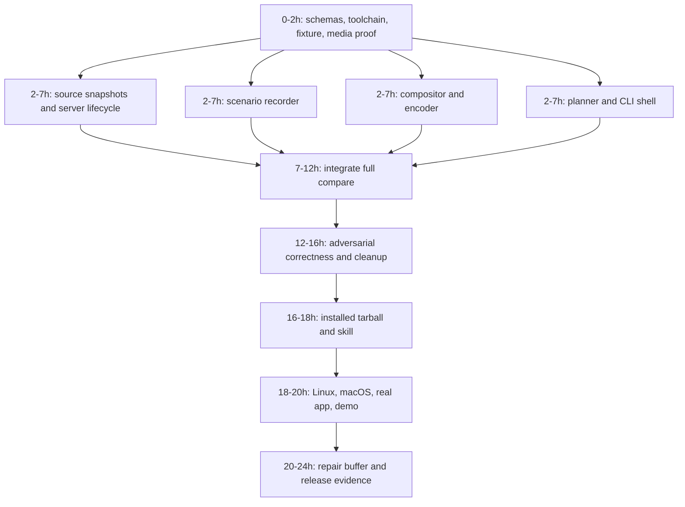
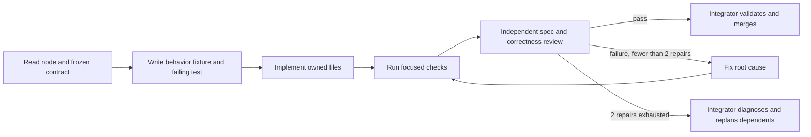

> Historical document sanitized for public distribution. Its content is not a byte-for-byte copy of the original development record. It is not current release evidence.

# 24-hour implementation graph

**Date:** 2 November 2026. **Input:** [audited specification](../spec.md), revision 0.2. **Status:** decomposition contract. Current execution and gate status are recorded in [build progress](../evidence/progress.md).

Use this document to create a separate detailed model plan for each node. Nodes name outputs, interfaces, owned files, dependencies and evidence; they are not vague feature prompts. The normative behavior is in the spec. Four owners means an integrator plus three workers; elapsed-time estimates assume that concurrency, prepared tools and immediate review. They are estimates, not benchmarks or a delivery guarantee.

## Graph and critical path

Critical path: **N0 → slowest of N1–N4 → N5 → N6 → N7 → N8 → N9**. A merge of four untested modules is not a milestone. N5 ends only when the built CLI produces a verified artifact. Work can finish early; saved time goes to the final buffer.

A compact machine-readable equivalent is [implementation-graph.json](implementation-graph.json). It includes required test IDs and a plan prompt template. All nodes are required; there is no MCP or other optional feature node hiding on the critical path.

## Coordination rules

- Integrator owns `src/schema/**`, `src/runner/**`, root dependencies/lockfile, CI and the spec. Workers own disjoint directories. Only the integrator changes shared types; changes require updating affected fixtures and notifying dependent owners.
- Each worker gets the spec, its node card, relevant shared schemas, input fixture files and dependency completion evidence. A missing dependency means blocked on that node, not permission to invent a different interface.
- Use isolated Git worktrees/branches for implementation after the project is initialized. Merge reviewed commits through the integrator. If working in one checkout, only designated owners write their directories and the integrator serializes root-file changes.
- Record per-node `evidence/<node>.md`: commit, exact commands and exit codes, test IDs, artifact paths/hashes, platform/tool versions, reviewer findings and dispositions. These evidence files are implementation outputs.
- A review may request repairs or explicitly reject a requirement with an owner-approved spec revision. It cannot declare a failing requirement out of scope merely to turn tests green.
- No model may publish, upload recordings, spend on providers, modify unrelated repos, or weaken trust requirements as part of a node. Release preparation stays local until the owner authorizes the concrete package/release.

## Node cards

### N0 — Freeze interfaces and prove prerequisites (hours 0–2)

**Owner:** integrator; workers may assist with isolated proof tasks. **Dependencies:** none.

**Files:** `package.json`, `package-lock.json`, `tsconfig.json`, `src/schema/*.ts`, `schema/*.v1.json`, `fixtures/next-app-basic/**`, `test/contracts/**`, `assets/fonts/**`, `evidence/N0.md`.

1. Pin Node24/package versions; check package APIs, licenses and compatible browser revision. Fix scripts for typecheck, test, integration and package-smoke before delegating.
2. Implement strict schemas/types and defaults exactly from spec §3–4/7; validate all spec JSON examples and negative examples. Publish generated JSON Schemas from the same definitions.
3. Create tiny npm Next App fixture source and a deterministic history generator with base/head color-copy-toggle changes. Add hover, delayed readiness, differing page heights and failure routes as fixture states. All data is synthetic.
4. Create sanitized synthetic CaptureBundle/Timeline examples for compositor work, and two supplied local fixture URLs for recorder tests. Match the agreed schema exactly.
5. Prove one masked screenshot → trusted HTML composition → two PNG segments → image2pipe H.264 encode/probe, without drawtext. Prove exact frame count and first/final frame. Check Git/npm/Chromium/FFmpeg/ffprobe/lsof/ps on supported hosts.

**Gate:** T01 baseline and T10/T11 capability spike pass; all public types and fixtures can be imported by the other nodes. If the spike fails, diagnose here before committing five hours of parallel implementation. Do not replace the keyframe product with a continuous recorder during the spike.

### N1 — Source isolation and runtime ownership (hours 2–7)

**Owner:** worker A. **Dependencies:** N0.

**Files:** `src/workspace/**`, `src/runtime/**`, `test/unit/{source,git,snapshot,runtime}*.test.ts`, `test/integration/lifecycle*.test.ts`, `evidence/N1.md`.

**Input:** frozen Plan and RunContext/Supervisor contracts, fixture histories. **Output:** WorkspacePair and owned ServerPair conforming to spec §5/11. Provide a pure inventory/ref helper for planner use; no startup in planner imports.

Implement full preflight on both refs/current tree, exact source inventory/snapshot overlay, independent npm installs, hash checks, loopback startup/readiness, process group ownership, cancellation, locks and owned cleanup. Test failure before success paths are considered complete. A metadata cache is not part of this node.

**Gate:** T02/T03/T04/T12/T13 focused tests. Demonstrate unchanged caller source/index/dependencies and independent side installs; kill a hung child without touching an unrelated process. Supply example WorkspacePair/ServerPair and resource cleanup evidence to N5.

### N2 — Declarative scenario execution (hours 2–7)

**Owner:** worker B. **Dependencies:** N0.

**Files:** `src/recorder/**`, `test/unit/scenario-states*.test.ts`, `test/integration/recorder*.test.ts`, `evidence/N2.md`.

**Input:** ServerPair with two supplied local URLs, normalized scenarios/settings, RunContext. **Output:** persisted CaptureBundle and masked source PNGs; no Git logic or encoding.

Implement only seven ops; exact locators; state matrix; source-frame pixelmatch computation persisted as changeRatio; fresh contexts; fixed Date; bounded settlement; pointer preservation; masking; same-origin main-frame scope and unsupported-event errors. A timed-out action must stop before a later step is considered. Test normal and failure captures through the same image helper. Own metric computation tests: known changed/equal pairs and null for every unverified pair.

**Gate:** T06/T07/T08/T09. Verify expected absence, required BEFORE failure and AFTER assertion failure independently. Inspect raw keyframes for correct hover state and missing secret. Pass captured fixture bundle to N3/N5.

### N3 — Presentation and exact encoding (hours 2–7)

**Owner:** worker C. **Dependencies:** N0.

**Files:** `src/composer/**`, `test/unit/timeline*.test.ts`, `test/integration/composer*.test.ts`, `evidence/N3.md`.

**Input:** synthetic persisted CaptureBundle and masked PNGs. **Output:** composed PNGs, Timeline, poster, verified MP4; no live application dependency.

Implement trusted fixed HTML renderer with local embedded font, validated data PNGs, zero HTTP requests, textContent labels, contain/letterbox geometry, partial states and deterministic poster selection. Stream integer PNG repetitions respecting backpressure, validate media with ffprobe, and support browser-free re-encoding from a complete timeline. Retain raw inputs after rendering failure and composed inputs after encoding failure.

**Gate:** T10/T11 plus metric-driven presentation cases from T07 (consume recorder-owned metrics; do not recompute/mutate CaptureBundle). Test dimensions, first/boundary/final frames, exact counts, caption injection strings, long captions and unsupported glyph fallback. Prove no drawtext dependency. Supply Media and timeline evidence to N5.

### N4 — Pure planning and CLI protocol (hours 2–7)

**Owner:** integrator. **Dependencies:** N0. N1 owns source/ref helper implementation; agree its pure signatures at N0 so fixture-backed planner work can proceed in parallel.

**Files:** `src/planner/**`, `src/cli/**`, `test/unit/planner*.test.ts`, `test/unit/cli*.test.ts`, `evidence/N4.md`.

**Input:** schema and source-inventory fixtures; source helper interface from N0. **Output:** versioned Plan and CLI argument/result protocol.

Implement explicit selection, conservative Next App detection across both endpoints, coverage and no-change distinctions, immutable plan hashes, stale checks, defaults/precedence and command preview. Add CLI help, JSON envelopes, consent handling and early-error mapping. No server/browser startup in plan; no executable config loader; no hidden future flags.

**Gate:** T01/T05/T14 focused tests. All documented examples parse; JSON stdout remains one document with noisy child diagnostics mocked on stderr. Plan uncertainty cannot become "no UI change."

### N5 — Full runner integration (hours 7–12)

**Owner:** integrator; workers fix only their own modules. **Dependencies:** N1,N2,N3,N4.

**Files:** `src/runner/**`, `src/cli/commands/**`, `test/integration/compare*.test.ts`, `evidence/N5.md`.

Wire the state machine and global deadline. Register resources before use. Derive manifest/status once after cleanup; write atomic metadata, only existing artifact links and the exact JSON envelope. Implement `compose`, `doctor`, and `clean` against the same ownership/validation rules. Verify CLI compare both with and without saved plan.

**Gate by hour 12:** full two-commit fixture from CLI produces the right video, poster, manifest and expected-absence summary. Required BEFORE failure returns exit3 with visible incomplete status. Early install/start failures return correct codes and no children remain. Worktree snapshot includes uncommitted edits without changing the caller.

If this gate misses, stop enhancements and assign all workers to diagnosed blockers. Do not remove source isolation or hide comparison failures to meet the clock.

### N6 — Adversarial integration and stability (hours 12–16)

**Owner:** workers A/B/C independently probe the neighboring module; integrator controls fixes. **Dependencies:** N5.

**Files:** `test/integration/**`, focused fixes in existing ownership directories, `evidence/N6.md`.

Run the complete T01–T15 matrix and trace each spec requirement to a case. Include concurrent runs, cancellation at phase boundaries, stale plans, symlink/traversal attempts, snapshot mutation, missing media prerequisite, server ownership race, private-data leaks and output reconstruction. Manually view success/partial media; compare repeated same-environment keyframes.

**Gate:** no unresolved P0/P1 correctness, integrity or process-cleanup defect. Reviewer documents findings; root cause fixes get focused regression tests followed by one full integrated rerun.

### N7 — Packed artifact and agent entry point (hours 16–18)

**Owner:** integrator plus worker C. **Dependencies:** N6.

**Files:** package allowlist/bin exports, `test/package/**`, `skills/show-what-changed/SKILL.md`, `README.md`, `docs/quickstart.md`, `evidence/N7.md`.

Pack and install in a fresh directory with no access to source-tree/dev dependencies. Run help, doctor, plan, full comparison and recompose. Check bundled schemas/font/license/skill. Document prerequisites with the pinned browser installation command. Write the generic skill to call CLI and parse its envelope, with at most two scenario authoring corrections and one operational retry; never make a failed required step optional just to pass. The skill does not auto-grant execution consent or upload.

**Gate by hour 18:** T16 package smoke passes, bin executable works, all shipped examples work with the installed artifact, and no private content is packed.

### N8 — Platforms, real app, public-facing evidence (hours 18–20)

**Owner:** worker A Linux CI, worker B macOS/real app, worker C docs/media; integrator reviews. **Dependencies:** N7.

**Files:** `.github/workflows/ci.yml`, `docs/{limitations,ci}.md`, README/demo references, `evidence/N8.md`.

Run Node24 Linux full gate and macOS smoke. Record one compatible real app's public/stateless route three times using disposable data. If representative web app requires unsupported auth/pnpm/monorepo features, use a compatible app and record that limitation rather than expanding scope. Produce a short synthetic-data demo that clearly says keyframe replay.

**Gate:** T16 platform evidence and T17. Document measured setup/run/encode times and platform differences; do not claim original performance targets or upload compatibility without measurements.

### N9 — Correction buffer and release candidate (hours 20–24)

**Owner:** integrator, all workers available for bounded repairs. **Dependencies:** N8.

**Files:** focused fixes, LICENSE/THIRD_PARTY_NOTICES/SECURITY/CONTRIBUTING, final evidence report, release notes and candidate tarball.

Freeze features. Fix remaining required defects, run relevant tests then final full gate, inspect demo and tarball, scan history/staged files, triage dependency advisories and check name/release ownership. Record final commit and tarball digest, supported matrix and known limitations. Prepare a concrete release for owner review. No public mutation occurs merely because the timer expires.

**Gate:** every required test has current evidence and no unresolved release-blocking finding. Otherwise state exactly which gate failed and deliver a runnable prototype, without a public-readiness claim.

## Bounded agent loop

Loop budget means stop repeating an ineffective tactic; it never means accept an unresolved defect. Evidence and interface compatibility determine completion. If a shared contract changes, increment the spec revision, update schemas/examples, identify affected nodes and rerun their contract tests before continuing.

Each model's detailed implementation plan must name exact files, fixture inputs, command and expected outcomes for its assigned tests. It must inherit scope cuts and explain unsupported cases. No separate plan may reintroduce a deferred feature under the label of robustness.
