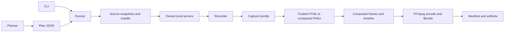
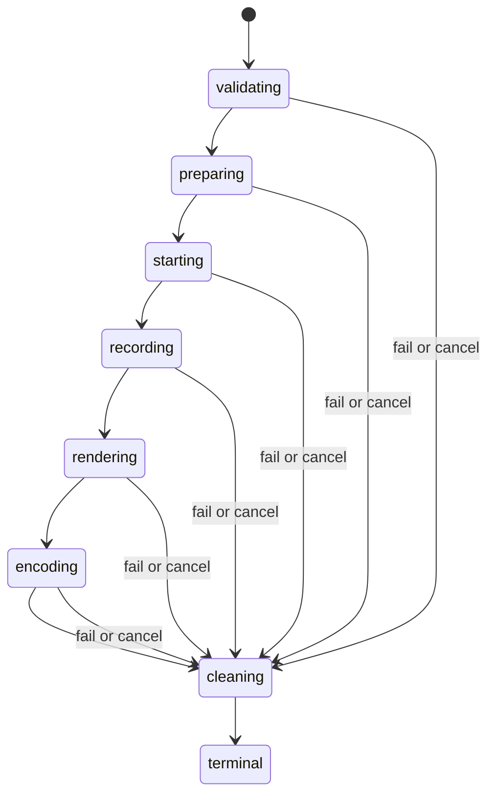

> Historical document sanitized for public distribution. Its content is not a byte-for-byte copy of the original development record. It is not current release evidence.

# show-what-changed — implementation specification

**Revision:** 0.2 · **Date:** 2 November 2026 · **Target:** public 0.1.0 experimental release within a 24-hour build window.
**Owner:** Tampraphon Lorattanasane · **Project license:** MIT.
**State:** audited design proposal; implementation and release evidence are still required. This document replaces the original roadmap as the v0.1 build contract. [Original](docs/audit/spec.original-2026-11-01.md) · [Audit](docs/audit/report.md) · [Implementation graph](docs/implementation-graph.md).

> When an agent finishes a UI change, replay a short scenario against the old and new source snapshots and produce one labeled BEFORE | AFTER MP4, poster, and machine-readable result.

The first release is a **step-aligned keyframe replay**: one settled screenshot per action, held for a readable duration. It does not record continuous motion or preserve action latency. Say this in the README, CLI help, skill, and manifest. Smooth scrolling, animations, performance comparisons, and real-time recordings are future work.

Normative words: **must** is required for this release; **deferred** means no advertised flag, schema field, stub, or hidden implementation is required. A documented limitation is not permission to report a failed comparison as successful. The archive is historical and cannot add requirements to this document.

## 1. Release boundary and success

### 1.1 Required scope

- One local Git repository, Node 24.x, npm, root `package.json` and committed `package-lock.json`; Linux and macOS. Pin exact dependency versions at build kickoff and record them in the lockfile and evidence. Other runtime majors are untested initially.
- BEFORE defaults to exact `HEAD`; AFTER defaults to a snapshot of the current filesystem (`WORKTREE`). Explicit refs select exact commits. An explicit merge-base option is available.
- Isolated, disposable workspaces and independent dependency installs. No mutation of the caller's source files, index, dependencies, or branch by the tool.
- A pure planner; basic Next.js App Router route detection; explicit routes and a custom start command for other apps. No claim of complete change coverage.
- One desktop viewport, 1280×800, DPR 1, Chromium. Up to three sequential scenarios, each up to twelve steps. Both sides advance through the same step indices.
- JSON config and scenarios; exact locators; explicit expected absence; truthful failure/coverage status.
- MP4, PNG poster, masked source keyframes, composed keyframes, manifest, and local `pr.md`. No upload.
- CLI, JSON output, a shipped generic agent skill, cleanup, diagnostic `doctor`, and an installed-package smoke test.

### 1.2 Deferred scope

MCP, live accessibility snapshots, planner server reuse, asynchronous job registries, editor-specific skill installers, interactive scenario recording, TS/YAML configs or scenarios, import graphs, additional framework adapters, auth profiles, env copying, database hooks, HAR replay, shared-backend mutation support, dependency/worktree caches, reused external servers, continuous/burst video, cursor animation, fuzzy locator fallback, diff boxes, GIF/WebM, multiple devices, monorepos, Windows, native apps, publishing/comment bots and a GitHub composite action.

An MCP adapter may be planned after this release; it must not consume the 24-hour correctness buffer. A CLI plus a skill already serves agents. There is no inference/model call inside the product.

### 1.3 Public acceptance

A clean install of the packed npm artifact must produce a correct comparison on the synthetic two-commit fixture, including an AFTER-only toggle and a retained hover state. It must also demonstrate a visibly incomplete comparison and exit 3 when a required BEFORE step fails. Repeated runs must leave the original checkout unchanged and no supervised child processes alive.

Public launch depends on §12 evidence, not on elapsed time. The 24-hour target assumes four concurrent owners, access to Linux CI and macOS, and local prerequisites. If required gates fail, deliver the runnable work with failure evidence; do not describe it as a completed release. This audit does not authorize package publication, external uploads, domain purchases, or repository visibility changes.

## 2. Architecture and ownership

Use one TypeScript ESM npm package. Build with `tsc`; use `commander`, Zod 4 (including its JSON Schema export), `playwright`, `pixelmatch`, `pngjs`, `semver` (engine checks), and `vitest`. Use Node `child_process.spawn` with argument arrays and `shell:false`. No `jiti`, `sharp`, native canvas, static FFmpeg bundle, router AST parser, or orchestration framework is needed.



| Module | Public interface | Owns | Must not own |
|---|---|---|---|
| `schema` | parsers and exported TS types for Config, Scenario, Plan, CaptureBundle, Timeline, Manifest, Result | versioned contracts and defaults | execution |
| `planner` | `plan(request): Promise<Plan>` | source inventory, ref resolution, routing, normalized scenarios, command preview | install, config execution, browser/server launch |
| `workspace` | `prepare(plan, run): Promise<WorkspacePair>` | copied source, frozen installs, source hashes | capture or user checkout mutation |
| `runtime` | `start(workspaces, plan, run): Promise<ServerPair>` | ports, subprocess supervision, readiness, cancellation | global PID-based cleanup |
| `recorder` | `capture(servers, scenarios, settings, run): Promise<CaptureBundle>` | browser actions, masked source PNGs and source-frame changeRatio | Git, route inference, encoding |
| `composer` | `render(bundle, settings, run): Promise<Timeline>`; `encode(timeline, run): Promise<Media>` | composed PNGs, poster, integer timeline, encoding | app actions, Git, installation |
| `runner` | `compare(request, context): Promise<Result<Manifest>>` | sequence, status reduction, final manifest, `finally` cleanup | duplicated module policy |
| `cli` | command parsing and `Result` printing | stdout/stderr protocol, signal handling | business logic |

`RunContext` contains run ID, absolute owned directories, a monotonic deadline, cancellation signal, private diagnostic sink, and a resource registry. It also holds a `Supervisor` interface (`spawn`, `stop`, `stopAll`) used by all execution modules. Every process, browser and workspace registers immediately upon creation. A failed module still leaves owned resources reachable by `finally`. Errors are typed and carry stable code, phase, optional side/step ID, sanitized message and next action.

Composer may launch its own isolated Chromium context for rendering the comparison template. It must not receive live recorder pages or depend on the apps staying up. Encoding/re-encoding consumes persisted composed PNGs and a timeline, with no browser required.

Repository layout:

```text
src/{schema,planner,workspace,runtime,recorder,composer,runner,cli}/
skills/show-what-changed/SKILL.md
schema/{config,scenario,plan,capture,timeline,manifest,result}.v1.json
assets/fonts/Inter-Regular.woff2
assets/fonts/OFL.txt
fixtures/next-app-basic/
test/{unit,integration,package}/
docs/{quickstart,limitations,ci}.md
README.md LICENSE THIRD_PARTY_NOTICES.md SECURITY.md CONTRIBUTING.md
```

## 3. Shared data contracts

### 3.1 Validation rules

- All persisted documents have `schemaVersion: 1`; reject unsupported versions. Strict object schemas reject unknown keys. Publish generated schemas in the package; generation must be deterministic and checked in CI.
- Config, scenario and plan input files are UTF-8 JSON, at most 1 MiB each; parsing never evaluates code. IDs match `[a-z0-9][a-z0-9-]{0,63}` and are unique within their parent. Scenario IDs are unique within a plan; step IDs are unique within a scenario.
- No user-supplied ID, ref, caption, filename or URL is interpolated into a shell/filter expression. Generated filenames use numeric indices and fixed suffixes. Paths from imported bundles must be relative, contained regular files; reject absolute paths, `..`, symlinks and missing images before reading them.
- Human text is capped at 160 Unicode code points, strips terminal control characters, and is assigned using `textContent` in the renderer. `fill.value` is at most 4096 characters and is never used in captions, logs, or public summaries. It may exist in the private plan; avoid real credentials entirely in this release.
- Read input paths relative to the invocation directory. Config lookup uses the Git root. All relative paths inside a saved plan or artifact document are relative to its documented root, never the current shell directory.
- All elapsed timings use Node monotonic time. Wall timestamps are ISO UTC strings. Fractions are finite; timeouts are positive bounded integers; encoded timeline boundaries are integer frames.

### 3.2 Result protocol

Every JSON command writes exactly one document to stdout, including on error. No spinner, child log, warning, debug message or newline-delimited progress record shares stdout. Diagnostics go to stderr. Commands without `--json` may format the same result for people.

```ts
type Result<T> = {
  schemaVersion: 1;
  command: 'plan' | 'compare' | 'compose' | 'doctor' | 'clean';
  status: 'ok' | 'partial' | 'failed' | 'nothing' | 'cancelled';
  exitCode: number;
  data: T | null;
  error: ToolError | null;
  warnings: Warning[];
};
type ToolError = {
  code: string; phase: string; side?: 'before' | 'after'; stepId?: string;
  message: string; hint: string; logPath?: string;
};
type Warning = { code: string; message: string; files?: string[] };
```

`status:partial` and exit 3 may include a useful manifest/artifacts. An early failure returns `data:null`. If a run directory exists, write a terminal manifest even when capture/encoding fails. `SIGKILL` and power loss cannot guarantee a terminal write; a subsequent doctor reports an abandoned running state.

### 3.3 Plan

`Plan` contains:

- `schemaVersion`, `planId` (SHA-256 of canonical JSON excluding ID and generated timestamp), `generatedAt`;
- `repoRoot` (canonical real path; private), `requestedBase`, `requestedHead`, `baseCommit`, `headCommit` (full Git OIDs), `baseResolution: exact|merge-base`, and `headKind: commit|worktree`;
- `sourceFingerprint` of the current source inventory when WORKTREE is used; `configDigest`; private `configSource: {path:string, rawSha256:string}|null` identifying the selected config file (including custom paths); resolved normalized config and scenarios;
- `changedFiles: {status, oldPath: string|null, newPath: string|null}[]` sorted by path;
- `coverage: {selected, unresolved, omitted, unsupported, complete}`; each route candidate has `path`, `reason`, `via` and optional reason for nonselection;
- `execution`: command argv arrays, cwd labels, intended install per side, and the network/side-effect notice. Never include environment values;
- `warnings`.

A saved plan is immutable input. Edit the config/scenario source then regenerate it; do not hand-edit the plan. `compare --plan` checks its ID, schema, repository path, config digest (including the bytes at `configSource.path`, if present) and WORKTREE fingerprint, plus current HEAD equals the pinned `headCommit` only when `headKind` is `worktree`, and fails `STALE_PLAN` (exit 2) on mismatch. Commit refs use the plan's resolved OIDs even if branches subsequently move; tell the user which OIDs are used. Without `--plan`, compare creates the same plan in memory.

Canonical JSON means recursively lexicographically sorted object keys, array order preserved, UTF-8 JSON without extra whitespace. Source fingerprints follow §5. A plan containing credentials is private input, not a publishable artifact.

### 3.4 Capture and timeline

`CaptureBundle` contains `schemaVersion`, run ID, exact browser/tool versions, capture mode `keyframes`, viewport/DPR, sanitized source labels, and ordered scenarios. Each scenario has its ID/title, ordered steps, and each step has:

```ts
type SideResult = {
  status: 'ok' | 'expected_absent' | 'skipped_by_side' | 'failed' | 'blocked';
  reasonCode: string | null;
  image: string;             // masked PNG or neutral/held safe frame, run-relative
  heldFromStepId: string | null;
  elapsedMs: number;
};
type CapturedStep = {
  id: string; op: string; caption: string; holdMs: number;
  before: SideResult; after: SideResult;
  changeRatio: number | null;
};
```

There is always a frame for both sides, including when the first navigation fails; use a generated neutral panel until a real safe capture exists. No screenshot taken for diagnostics bypasses the masked capture path. A held frame never has status `ok` for a later failed/blocked step. Do not serialize `fill.value` or full browser error objects into the bundle.

`Timeline` contains `schemaVersion`, run ID, `fps:30`, `templateVersion:1`, `width:1920`, `height:686`, `totalFrames` and `segments[]`. A segment has `kind:title|step`, nullable scenario/step IDs, a composed PNG path, `startFrame` and `durationFrames`. Starts are cumulative, durations positive, boundaries half-open; the final endpoint equals totalFrames. Also record selected poster path and the hashes of all composed images. Validate limits and hashes on `compose`.

## 4. CLI and config

Only these commands/flags are in v0.1. Unsupported options fail with exit 2 and a concrete alternative.

| Command | Behavior |
|---|---|
| `show-what-changed [compare]` | plan, request execution consent, snapshot, install, capture and compose |
| `show-what-changed plan` | validate, inspect Git and infer routes, write `.show-what-changed/plan.json`; never execute repo code |
| `show-what-changed compose <runDir>` | re-encode saved composed PNGs/timeline; does not run app code or change capture outcomes |
| `show-what-changed doctor` | read-only diagnosis, compatible browser install command, system FFmpeg/ffprobe capability check |
| `show-what-changed clean <runId>` | delete one inactive owned run and its owned workspace residue under §11; refuse active/uncertain ownership |

Common: `--json`, `--help`, `--version`. Compare/plan: `--base <ref>` (HEAD), `--head <ref|WORKTREE>` (WORKTREE), `--merge-base` (off), repeatable `--route <path>`, repeatable `--scenario <file>`, `--config <file>`. Compare alone: `--plan <file>`, `--allow-exec`, `--timeout <seconds>` (600, maximum 3600), `--ci`. `--plan` excludes source/config/scenario/route overrides. `--ci` is also enabled by `CI=true` and never prompts. `--allow-exec` is explicit permission for this invocation, not persistent trust. Agents may use it only with user authorization to run this app's code.

`--scenario` and `--route` are mutually exclusive. CLI routes replace configured routes. CLI scenarios replace automatic scenario generation. At most three routes/scenarios; excess explicit input is an error. Auto candidates are capped at three and omissions are reported. Config precedence: built-in defaults → JSON config → CLI, applied once during planning. No environment variable silently grants trust or changes a plan.

Example after installing the pinned release and prerequisites:

```bash
show-what-changed plan --route /pricing --json
show-what-changed compare --plan .show-what-changed/plan.json --allow-exec --json
show-what-changed --base v1.2 --head v1.3 --route /pricing
show-what-changed --base main --merge-base --head HEAD --route /pricing
```

First interactive compare shows the two source identities, source file counts, install/start argv, network notice and output location, then asks for consent if `--allow-exec` is absent. Noninteractive execution without that flag exits 7 before creating worktrees, installing or launching. Plan/doctor never need repo-execution consent. Doctor is allowed to run tool-owned Git/version/capability probes with hooks/external diff/fsmonitor disabled; it never invokes app scripts.

Optional root `show-what-changed.config.json`:

```json
{
  "schemaVersion": 1,
  "framework": "auto",
  "dev": {
    "argv": ["npm", "run", "dev", "--", "--hostname", "127.0.0.1", "--port", "{port}"],
    "readyPath": "/",
    "readyStatus": [200],
    "timeoutMs": 120000
  },
  "routes": {
    "include": [],
    "params": {"/blog/[slug]": ["/blog/example"]}
  },
  "capture": {
    "fixedTime": "2026-01-15T10:00:00.000Z",
    "maskSelectors": [],
    "stepTimeoutMs": 5000,
    "holdMs": 800
  }
}
```

The example's dev argv is the automatic Next default; custom apps require an explicit `dev.argv`. Framework enum is `auto|nextjs-app|custom`. `auto` recognizes `next` plus root `app/` or `src/app/` (both is an error); it otherwise needs custom config and explicit routes. No zero-config promise for Vite or arbitrary package scripts.

`dev.argv`: 1–32 string arguments, `{port}` required as its own argument exactly once, no other interpolation. `readyPath` is a validated app-relative path; `readyStatus` is 1–10 exact HTTP status integers, default `[200]`, never an inclusive range. `timeoutMs` is 1000–120000. `fixedTime` is a UTC ISO timestamp or `null` to disable. Masks are at most twenty CSS selector strings. Step timeout is 100–10000 ms; hold is 200–2000 ms. Default route sample map is empty. No env, hooks, arbitrary evaluate, credentials or command strings are part of config.

## 5. Git semantics, snapshots and dependencies

### 5.1 Ref and diff semantics

- Require a nonbare repository with an existing commit and cleanly resolved index; reject unmerged entries, sparse checkouts, submodules, LFS pointers, symlinks and nonregular source files for v0.1. Reject workspaces/monorepos (`workspaces`, `pnpm-workspace.yaml`), unsupported package managers, missing lockfile, and conflicting lockfiles before execution. Report the file and supported alternative. No automatic fetch, stash, checkout of the caller, reset, or upgrade.
- Resolve requested refs once using `git rev-parse --verify --end-of-options <ref>^{commit}`; reject ref values beginning `-`. Full OIDs are strings, not assumed 40 characters. Empty/missing refs fail with exit 2.
- Without `--merge-base`, render exact resolved BEFORE and AFTER. With it, BEFORE becomes the unique merge base of the requested base commit and the resolved AFTER commit (HEAD for WORKTREE). Zero or multiple merge bases fail with an actionable error. No hidden default-branch lookup.
- Commit comparison: `git diff --no-ext-diff --no-textconv --name-status -z --no-renames BASE_OID HEAD_OID --`. Rename detection is deliberately disabled; a rename is a deletion plus addition and both paths are considered.
- WORKTREE comparison: compare the base-tree content/mode inventory directly against the final filesystem inventory in §5.2, including `git ls-files --others --exclude-standard -z` candidates. Do not use `git diff BASE --` as the authority: its index-mediated behavior can disagree with the rendered snapshot and invoke clean filters. In particular, a file removed only from the index but still present on disk is not deleted in the rendered state, even if newly ignored. The rendered state is final disk contents, not a union of staged and unstaged patch text. A staged edit reverted on disk must not appear as changed content.
- Parse filenames as NUL-delimited data, sort deterministically, and do not print control characters to a terminal. Ref/path input is always an argument. Disable Git hooks for managed worktree operations and fsmonitor/external diff for inspection. Reject invalid UTF-8 paths in v0.1 instead of corrupting them.

### 5.2 WORKTREE snapshot algorithm

WORKTREE means a captured filesystem snapshot, not a live checkout server. Hold a tool-level repository run lock during preparation and execution; this prevents another tool run, not an editor, from writing.

1. Enumerate the union of paths tracked by HEAD, paths tracked by the index, and nonignored untracked paths. Exclude `.git/`, `.show-what-changed/`, `node_modules/`, `.next/`, `dist/`, `build/` from tool inputs. If such generated directories are tracked, fail with `UNSUPPORTED_SOURCE_LAYOUT` rather than silently omit tracked source. Ignore ignored untracked files, including typical `.env.local`; print that they are not copied.
2. Validate regular files, modes, path containment, count and byte bounds. Reject file-to-directory or directory-to-file transitions between the pinned checkout and final snapshot as `UNSUPPORTED_SOURCE_LAYOUT` in v0.1; do not attempt an ambiguous overlay. Limit source snapshot to 20,000 files and 200 MiB total. Exceeding limits fails early with the measured count/size and a support limitation.
3. For each path record existence, executable bit, length, SHA-256 of bytes; deletions have an explicit absent marker. Sort by UTF-8 path bytes. Hash this inventory as `sourceFingerprint`. Include index identity separately for the preservation test, not as rendered content.
4. After execution consent, create a fresh detached worktree at the plan's pinned `headCommit` in a private owned temporary directory; overlay captured final bytes/modes, delete files absent from disk, and add nonignored untracked regular files. Never follow source or destination symlinks. Ensure all path ancestors remain inside the owned workspace. Use exclusive owned temporary files and atomic rename for copies.
5. Re-enumerate/re-hash source input immediately after copying. If it differs from the plan/inventory, fail `STALE_SOURCE` (exit 2), clean the incomplete workspace, and ask for a rerun. Do not silently capture a mixture of source revisions. This is best-effort detection of concurrent edits, not a filesystem-wide atomic snapshot guarantee.
6. From this point the AFTER app runs only from the owned snapshot. Later edits to the caller do not affect it. Persist the hash of actual snapshot bytes. Require the destination content/mode inventory to match the intended snapshot as well, catching change-and-restore races during copying. Re-enumerate and hash the full eligible source inventory, including new nonignored files, after install and after capture; if they changed, invalidate provenance and return failed exit 5 before capture, or partial exit 3 if media can be produced after capture, never success. Generated ignored build outputs are outside this identity.

Source fingerprints identify bytes supplied to the app. They do not identify external APIs, database contents, remote fonts, system libraries, environment, or nondeterministic server code. The manifest explicitly records `dataParity: unverified`.

### 5.3 Commit workspaces and installation

For each commit side use a separate detached worktree with a unique run/side path, even when both OIDs match. Git hooks are disabled. Local checkout attributes such as line-ending conversion can affect materialized files; custom filters are rejected; compute actual source-file hashes after materialization and record them alongside OIDs. Reject LFS pointer content rather than downloading. Apply the full inventory revalidation before/after install and capture to BOTH sides, including newly created nonignored source files. Do not reuse any prior worktree or symlink the caller's node_modules.

Both sides require a compatible root npm lockfile. Run `npm ci --no-audit --no-fund` independently in each owned side. npm's download cache may be shared; installed trees/build outputs may not. Install scripts are real arbitrary code and are included in consent. Detect `packageManager` if supplied and reject a non-npm value. `engines.node` incompatibility fails before app startup. Missing npm/Chromium/FFmpeg is exit 8, not an install attempt.

Consented app `npm ci` may download app dependencies. The tool never automatically installs or downloads its own prerequisites (npm/tool packages, browser, OS dependencies or FFmpeg). README and doctor give explicit setup commands using the tool's pinned Playwright version. Shipping `playwright` includes the matching installer entry point; never invoke an unqualified latest `npx playwright` to fix a mismatch. Private registries requiring credentials, local file/link dependencies and workspace dependencies are unsupported in v0.1. Inspect both manifests and lockfiles for these conditions before execution. The full preflight examines both selected trees and the WORKTREE candidate inventory, not only changed files. Preflight filter configuration/attributes before any Git operation that could convert working-tree content, including diff/status/checkout. Git checkout filter configuration is rejected in v0.1 (any configured filter driver or `filter=` attribute); do not run smudge/clean commands. Source-materializing worktree creation starts only after that check and consent.

## 6. Planning routes and coverage

Planning reads both endpoint inventories, so a deleted or renamed page is still a candidate. It does not start a server or inspect live DOM. Scenarios are supplied by a person/agent from its app knowledge, or conservatively generated.

Next App support: `app/**/page.{js,jsx,ts,tsx,mdx}` and `src/app/**/page.*`; strip route groups `(name)`. Recognize `[id]`, `[...slug]`, `[[...slug]]` only through explicit route samples in `routes.params`. Ignore `route.*` API handlers and `_private` subtrees. Parallel slots `@slot` and intercepting routes are unsupported and reported; do not silently reinterpret them. Decode neither filesystem names nor arbitrary URLs into executable paths.

- Direct page changes map to the corresponding route from either side.
- `layout`, `template`, `loading`, `error`, and `not-found` changes map to descendant page candidates in that subtree.
- Shared components, styles, global configs, unknown imports or custom frameworks are unresolved unless explicit routes/scenarios are supplied. Do not guess that `/` covers the whole change.
- Explicit CLI scenarios select their initial `goto` route; CLI routes override config includes; config includes override inference. Explicit selection is recorded as such and does not claim exhaustive changed-route coverage.
- Automatic route ranking is direct first, scoped descendant second, then ascending normalized route string. Deduplicate first; select at most three. List overflow as `omitted`. Missing dynamic samples go to `unresolved` with a `--route` hint.
- Removed/new routes have no automatic permission to fail navigation. The caller must supply an appropriate side-specific scenario (for example an AFTER-only `goto` with a neutral BEFORE panel). A 404 is not evidence that a selector was expected absent.
- `coverage.complete` is true only if every inferred UI candidate is resolved and selected with no unsupported structure; explicit selections set it false with reason `EXPLICIT_SELECTION`. This does not make every explicit run partial: only failures or **automatic** coverage gaps make exit 3. In automatic mode, any nonempty unresolved, omitted or unsupported bucket is a coverage gap; with at least one captured scenario it yields partial, and with none selected it yields exit 2 as below. Describe coverage separately from execution success.
- If no changed files and no explicit selection, exit 4 `NOTHING_CHANGED`. If only proven docs/tests-only paths changed, exit 4 `NO_UI_CANDIDATES`. If changes might affect UI but no route is resolved, exit 2 `ROUTE_REQUIRED`. Never describe uncertainty as proof of no visible change.

Proven docs/tests-only patterns: `**/*.md` except `.mdx`, `docs/**`, `test/**`, `tests/**`, `**/*.test.*`, `**/*.spec.*`. Root/package/build config changes are unresolved, not automatically ignored. Config/scenario files and internal tool output are excluded from UI-change classification. If classification is ambiguous, request an explicit route in the diagnostic.

Automatic scenario for a concrete route: `goto` that route, then `scrollBy {y:640}`, then another `scrollBy {y:640}`. Scroll is instant and clamps independently to each page height. Both sides have the same three steps; it is a bounded sample, not whole-page coverage. Interaction changes require a supplied scenario.

## 7. Scenario grammar and execution states

Example `pricing.scenario.json`:

```json
{
  "schemaVersion": 1,
  "id": "pricing-toggle",
  "title": "Switch yearly pricing",
  "steps": [
    {"id": "open", "op": "goto", "path": "/pricing"},
    {"id": "ready", "op": "expectVisible", "target": {"role": "heading", "name": "Pricing"}},
    {"id": "toggle", "op": "click", "target": {"role": "switch", "name": "Yearly"}, "allowMissing": ["before"]},
    {"id": "saving", "op": "expectVisible", "target": {"text": "Save 20%"}, "only": "after"},
    {"id": "hover", "op": "hover", "target": {"role": "button", "name": "Get Pro"}},
    {"id": "poster", "op": "screenshot", "note": "Hover on the plan button"}
  ]
}
```

A scenario has schemaVersion, ID, title, and 1–12 steps. Its first step must be `goto`; `only` may restrict it for added/deleted routes. Every side starts on a neutral blank page in a fresh browser context. Scenario state is never reused across scenarios. Each step contains `id`, discriminant `op`, the exact operands below, optional `note`, `only:before|after|both` (both default), `allowMissing:Side[]` (empty default), `timeoutMs`, `holdMs`.

| Op | Required operands | Meaning |
|---|---|---|
| `goto` | `path:string` | navigate to app-relative path using DOMContentLoaded; HTTP status 200–399, transport success and allowed final origin required; same-document case below |
| `click` | `target:Locator` | Playwright click, actionability and strict matching required |
| `fill` | `target:Locator`, `value:string` | replace input contents; value excluded from output text |
| `hover` | `target:Locator` | retain hover until an explicit later action moves pointer |
| `scrollBy` | `y:integer`, -1600…1600 | instant `window.scrollBy(0,y)`; no smooth animation |
| `expectVisible` | `target:Locator` | wait for exactly one target to become visible; assertions capture a frame too |
| `screenshot` | none | capture present state without moving pointer or altering focus |

`Locator` is exactly one of `{role,name?}`, `{label}`, `{text}`, `{testId}`, `{css}`. Role values must be valid Playwright ARIA roles. Text/name/label are literal strings, exact matching; no regex-string magic, XPath, nth, within, fuzzy matching or fallback lists. CSS is allowed with a warning. Ambiguity (more than one match) is a failure. Maximum locator string length is 512 characters.

App-relative path starts with `/`, is at most 2048 characters, and when resolved against the side's origin must remain on that origin. Reject `//host`, backslashes, credentials, control characters and alternate URL schemes. A `goto` returning no response is successful only for a same-document fragment transition from a previously successful document to the exact requested app-relative URL; any other null response is a navigation failure. All main-frame navigations and redirects must remain on that side's allocated origin. Popups/new pages, downloads, file choosers and dialogs are unsupported: dismiss/close and fail that side's current step. This is a scope check, not network isolation; subresources and app-server traffic may still use the network.

`allowMissing` is legal only on locator operations and only applies to sides included by `only`. It permits zero matches after bounded locator presence polling; it never excuses ambiguity, disabled controls, hidden existing elements, assertion failure, application crash or a timeout after the element was found. `only` exclusion occurs immediately with no lookup. A required failure blocks every later step on that side of that scenario. The other side continues, and a new scenario gets fresh contexts.

| Condition on a side | Status | Picture | Run effect |
|---|---|---|---|
| operation succeeds | `ok` | new masked capture | none |
| side excluded by `only` | `skipped_by_side` | last safe frame or neutral panel, clear label | expected; not a verified pair |
| zero matches and allowed | `expected_absent` | last safe frame, "Expected absent in BEFORE/AFTER" | expected; not a verified pair |
| required missing, ambiguous, unready, assertion/nav error | `failed` | safe failure capture if possible, otherwise last safe frame | partial, exit 3 |
| previous required failure | `blocked` | held safe frame, "Not executed after step …" | partial, exit 3 |

Source `changeRatio` is computed only for `ok/ok` pairs of equal dimensions. Every other pair has `null`; it cannot increase counts of verified unchanged steps. Each scenario outcome is `ok|partial`; the reducer in §10 defines the run status.

## 8. Recorder and determinism

Launch one pinned Chromium process with two fresh contexts per scenario; viewport 1280×800, DPR 1, locale en-US, timezone UTC, light scheme, reduced motion, service workers blocked. Keep sandbox defaults; do not add `--no-sandbox`. Use no saved auth state, extensions, browser profile or trace recording.

For each step, execute both eligible sides concurrently, await both terminal results, then proceed. There is no cross-scenario concurrency. Capture exactly one masked keyframe after settlement. No arbitrary scenario JS, app evaluation beyond the tool's fixed scroll/settle logic, CDP capture, HAR or native recording.

- Use `page.clock.setFixedTime` before navigation when configured. It fixes browser wall-clock Date while real timers continue; do not pause `requestAnimationFrame`. Use Node time for elapsed measurements.
- Do not replace `crypto.randomUUID`, `crypto.getRandomValues` or server randomness. Seeded Math.random is deferred. Rendered randomness/server dates remain a documented source of noise.
- Disable transitions/animations via the tool's own style and screenshot options, hide caret, and force instant scroll. Changes to animations are outside this release's evidence claims.
- After each action/assertion, wait for `document.fonts.ready` and two animation frames within the same whole-step deadline. Failed settlement is a step failure, not silently accepted. No network-idle wait. For delayed data the scenario must use `expectVisible` for the relevant ready state.
- Fixed time and fresh contexts do not ensure backend/data equality. v0.1 scenarios must use read-only or disposable app data. A click can mutate a backend; the tool cannot infer that it is safe.
- Every image is captured through one helper with all `maskSelectors`, a solid mask color, viewport-only dimensions and caret/animation settings. Invalid CSS fails before capture; absent selectors are allowed. This is opt-in region masking, not automatic PII detection or blur. Do not persist an unmasked image as a fallback.
- Do not park the pointer before screenshots/checks. A hover followed by a screenshot must retain the hover. Pointer annotations are deferred.
- Never hide runtime/compiler error overlays to make a capture look healthy. Page errors, navigation failures and server exit fail the affected side. Console warnings are bounded diagnostics and do not by themselves fail the run. Error overlays detectable in the supported fixture fail it; arbitrary application error UI requires an explicit assertion.

Whole-step timeout includes locator polling, action, settlement and screenshot. If Playwright has no cancellation API for an active operation, timeout/cancellation closes that context to break it and holds the last safe frame. Do not leave a timed-out action running in the background and start a later step.

## 9. Composition and media

### 9.1 Presentation

Render a fixed trusted HTML template in a separate Chromium context (no live app DOM). Its only variable inputs are already masked PNG data URLs and sanitized text through `textContent`. Bundle the OFL font and its license, embed the font locally, block all network requests, disable animations and wait for font/image decoding before screenshot. Never insert input as HTML, CSS, script, URL navigation or remote font references. Limit each PNG to 16 MiB compressed, accept only the declared 1280×800 source or 1920×686 composed dimensions as appropriate, and reject unexpected decoded sizes before rendering or encoding. Renderer context has DPR 1, no application storage/init scripts/clock overrides, and a restrictive CSP allowing only its own inline style and PNG/font data URLs. Embed the font as a data URL, so network blocking does not prevent it loading. A missing asset or failed image decode fails rendering; raw masked frames remain available.

Canvas is always 1920×686. Each source viewport is letterboxed without cropping or stretching into a fixed 958×598 panel using `object-fit: contain`; a 4 px divider occupies the center, a 48 px label row is above, and a 40 px caption row below. Labels include BEFORE/AFTER and shortened source identity. No output upscaling or alternate layout is exposed. Status badges/panels are visible in the affected half; capture/coverage/provenance incompleteness known before rendering must be visibly marked in the scenario/run title and captions. Normalize line breaks to spaces. Text uses one line with deterministic ellipsis within measured bounds; never cover the source image to fit long labels.

Persist one composed PNG per step and one title PNG per scenario. Title cards name the scenario, initial route, capture mode and execution/coverage caveats. A title exists even for the first scenario. The initial release guarantees English labels/captions; preserve Unicode source names in JSON, but map caption/label characters outside printable ASCII to `?` and add `FONT_GLYPH_UNSUPPORTED` rather than claiming multilingual font coverage. This applies only to presentation text, never the app screenshots or saved Unicode JSON; no runtime font-glyph parser is needed. Pin template version `1` in the timeline. All artifacts visibly communicate that these are keyframes; visually incomplete capture cannot appear as a full verified comparison. A cleanup-only failure discovered after encoding is an operational partial, reported in the final manifest, CLI result and pr.md without retroactively claiming the pictures are invalid. The poster uses the same layout and status policy.

### 9.2 Timeline

At FPS=30, each step duration is `ceil(holdMs * 30 / 1000)` frames; default 24 frames (800 ms). Every scenario title is exactly 30 frames. Runtime elapsed milliseconds do not affect presentation length. TotalFrames is the sum once, with no repeated floating-point rounding. Maximum output is three scenarios × (1 second title + twelve × 2 seconds hold) = 75 seconds.

The encoder uses persisted composed PNGs and an explicit integer-frame schedule. It must produce exactly TotalFrames; image-concat last-frame behavior must be covered by a test. Stream complete composed PNG bytes to FFmpeg `image2pipe` at input framerate 30, repeating each PNG exactly `durationFrames` times in segment order, and set the output frame limit to TotalFrames. Respect stdin backpressure, keep only the current image buffer in memory, close stdin after the final frame, and drain stderr concurrently. This avoids ffconcat duration and final-image ambiguity. No text or pixel-diff computation is performed inside FFmpeg.

Encode H.264 (`libx264`), yuv420p, CFR 30, CRF 23, preset veryfast, faststart, no audio. Use system FFmpeg and matching ffprobe; explicit executable paths are allowed only through doctor-validated CLI environment `SWC_FFMPEG`/`SWC_FFPROBE`, not from repository config. Command arguments are arrays; do not require drawtext/libass/hstack. Doctor performs a tiny temporary encode/probe, not just `--version`. Capability checks are command-specific: compare needs browser/font plus FFmpeg/ffprobe; encode-only compose needs only validated inputs and FFmpeg/ffprobe, never Chromium/font installation. Doctor reports capabilities independently. Missing required capabilities exit 8.

ffprobe validates dimensions, codec, pixel format, rational FPS, decoded frame count and duration within one frame. Extraction tests verify first, transition-adjacent, midpoint and final frames. File size is reported; no promised GitHub upload-size guarantee and no automatic quality-degrading retry. Re-encoding is atomic: use a temporary output, validate, then rename.

### 9.3 Metrics, poster and recomposition

The recorder owns computing and persisting changeRatio in CaptureBundle; the composer reads it without mutating the bundle. Use pixelmatch on masked source PNGs before labels/status overlays/resizing, threshold 0.1 and anti-alias differences excluded. `changeRatio = differingPixels/(1280*800)`; it is a visual-difference statistic, not regression correctness or semantic equivalence. `visuallyUnchanged` means ratio <0.001. Noise may count as change. No SSIM, connected-component boxes or DOM diff in v0.1.

Choose the first step with the highest valid changeRatio as the poster; ties retain scenario/step order. If no valid pair exists, use the first composed step with an incomplete badge. Copy that composed PNG to poster.png. Poster has no hard compressed-byte guarantee.

`compose <runDir>` validates the saved timeline and composed-image hashes, then re-encodes MP4 and restores the poster. It needs neither app servers nor Chromium. It cannot change layout/captions/settings or rerun steps. Persist `comparisonOutcome` (capture, coverage and provenance), `cleanupOutcome` and `encodingOutcome` independently in manifest metadata before encoding. A successful compose atomically updates media and its hashes/sizes/paths, current encoding-tool versions and encodingOutcome, recomputes terminal status from preserved comparison/cleanup outcomes, and refreshes pr.md/result; retain old errors in a separate history if useful. It preserves comparison outcomes; it may replace a previous encoding error with success, but cannot repair a failed browser action or invalid provenance.

## 10. Artifacts, status and errors

Create run IDs as UTC milliseconds plus 8 random bytes, using an exclusive mkdir. The run directory is `.show-what-changed/runs/<runId>/` at the Git root, mode 0700 where supported. Before any plan, run, lock or artifact write, validate canonical containment and reject symlinks or non-directory ancestors in the output root or its managed parent chain; never replace an existing file not registered to this run. Create output files as private (0600) by default. Tool output never participates in source fingerprints or route inference. Do not edit `.gitignore` automatically; tell the user to ignore `.show-what-changed/` before committing.

```text
runs/<runId>/
  manifest.json             # final public-oriented summary, atomic writes
  capture.json              # sanitized capture bundle
  timeline.json             # exact encoding input and image hashes
  compare.mp4
  poster.png
  pr.md
  frames/000-before.png ...
  composed/000-title.png 001-step.png ...
  private/plan.json          # may include input values and local paths
  private/logs/              # bounded diagnostic logs; excluded from sharing guidance
```

Manifest contains schemaVersion, tool version, runId, state/status/exitCode, captureMode, start/end timestamps, requested/resolved source identities and materialized hashes (no absolute repo path), browser/Node/FFmpeg versions, config/scenario digests, viewport, dataParity, coverage, per-scenario/per-step statuses, timeline summary, relative artifact paths, artifacts' SHA-256/byte sizes, warnings/errors, phase timings and cleanup result. Missing artifacts are `null`, never nonexistent advertised paths. No fill values, secrets, whole environment, absolute usernames, raw HTTP headers/bodies or full app URLs belong in it. Sanitize diagnostics before including them.

Run state transitions:



Status reduction after cleanup:

| Condition | Result / exit |
|---|---|
| expected steps only, media valid, provenance valid, automatic coverage complete or explicit bounded selection | `ok` / 0 |
| valid media but any required failure/blocked side, automatic coverage gap (unresolved/omitted/unsupported), source provenance mutation, or cleanup failure | `partial` / 3 |
| no changes/candidates as narrowly defined in §6 | `nothing` / 4 |
| input/schema/ref/stale plan/unresolved route/unsupported repository | `failed` / 2 |
| execution consent missing | `failed` / 7 |
| workspace or install fails | `failed` / 5 |
| server cannot start/become ready or exits before capture | `failed` / 6 |
| missing environment capability | `failed` / 8 |
| rendering/encoding/output validation fails | `failed` / 9 |
| overall timeout | `cancelled` / 10 |
| SIGINT / SIGTERM | `cancelled` / 130 or 143 |
| unexpected internal defect | `failed` / 1 |

Fatal errors take precedence over partial outcome. Cancellation takes precedence if it arrives before terminal result; retain prior failures in errors[]. If cleanup also fails, append it without overwriting an earlier fatal/cancel code. A cleanup error after otherwise successful media is partial. A server exit during recording fails that side, blocks its remaining steps, then composition may produce partial media. `summary` counts verified pairs, visually changed verified pairs, expected absences/exclusions, failed/blocked steps and coverage omissions separately.

`pr.md` is local preparation: a short summary, local poster/video paths and instructions to attach reviewed artifacts manually. Local paths are not presented as playable remote URLs. No placeholder is advertised as a completed upload. Do not claim compatibility with another skill unless tested against a documented version.

## 11. Execution, cleanup and trust

### 11.1 Scope of trust

Permission to run repository code is not a sandbox. npm install scripts, dev commands and the application can read local files/network under the user's account. The tool promises **no tool telemetry and no automatic artifact upload**. It does not promise no egress. Page content/scenarios are untrusted data, never instructions to change consent or run shell commands.

Per-run consent covers the two resolved source identities and exact command argv shown in the plan. No persistent trust file, `--yes`, or `SWC_TRUST` is shipped. Never import executable config during discovery. CI must pass `--allow-exec` deliberately; examples use ephemeral hosted runners, read-only repository permissions, no credentials/secrets, no privileged cache, and never execute fork code in a privileged `pull_request_target` job.

Build process environments from an allowlist: PATH, HOME, TMPDIR, platform temp variables, LANG, LC_ALL, plus CI and tool-set PORT, SWC_SIDE, SWC_RUN_ID, BROWSER=none, NEXT_TELEMETRY_DISABLED=1. Do not propagate arbitrary parent tokens. HOME is not isolation: tools may still read user configuration/credentials; document this. Private diagnostic logs are size-capped to 5 MiB per process; summarize truncation. Redaction of known token patterns/values is defense in depth, not a guarantee; do not print raw child log tails to stdout or package private logs for sharing.

### 11.2 Server lifecycle

Allocate two candidate loopback ports from 4310–4399; exclude duplicates. Port probing has a race, so check that no listener appeared immediately before spawn. Start each command in an owned process group, set assigned PORT and argv placeholder. Never accept silent fallback to another port. Next default binds 127.0.0.1 explicitly. For custom commands document their obligation to honor the exact port and loopback binding.

Poll readyPath every 250 ms within the server/overall deadline; each HTTP attempt times out after 1 second and does not follow external-origin redirects. Require an exact configured status and a still-live owned process. Require system `lsof` and `ps` (doctor checks these before execution). Use machine-readable lsof/ps output. Inspect every LISTEN socket on the assigned port: each listener PID must have the live spawned process-group ID and bind only to loopback, never wildcard/nonloopback addresses. Check listener ownership to the spawned process group before accepting readiness; if ownership cannot be established, fail with a diagnostic rather than recording an unrelated service. Next's development port-conflict exit is not treated as readiness. A race retries with a new pair at most twice, only after stopping owned processes.

No automatic warm-up of every route: default readiness GET is the only pre-scenario navigation and must be safe. It can compile the app. Actual route readiness is proven by scenario navigation and assertions. Server start timeout is per side but bounded by the global run deadline. Either side's startup failure terminates both sides.

### 11.3 Cancellation and deletion

The supervisor owns install, start, browser, render and FFmpeg processes, not just dev servers. On success, failure or signal, stop new work, close contexts/browser, send TERM to owned process groups, wait up to 3 seconds, then KILL survivors. Bound total cleanup to 10 seconds. Idempotent cleanup runs once and may be called again safely. Persist cleanup success/errors.

A repository lock is acquired atomically using an owned lock directory; a second run returns `RUN_ACTIVE` exit 2. Never reclaim a lock or kill a process merely because a persisted PID exists or is absent: PIDs are reusable. During the process lifetime use the live child handle plus group identity. After a crash, doctor lists stale owned paths and possible processes; it never automatically kills them. The user may stop a process manually, then use clean. Lock recovery requires verifying the original owner is gone and no owned workspace is active; uncertain cases fail safely.

`clean <runId>` operates only on an exact registered tool-owned run/temp workspace, validates its ownership marker and canonical containment, refuses symlink roots and active processes, and never uses Git global prune, arbitrary recursive paths, or an all-repos cleanup. Normal cleanup removes private temporary workspaces using their exact registered Git worktree paths and removes the run lock; it retains media/metadata. Never delete the caller's files or node_modules. No automatic age/count pruning in v0.1. SIGKILL/power failure may leave files; disclose that and support manual recovery.

## 12. Verification and release gates

The matrix below is required evidence, not a list of tests that have run. Each test has a deterministic fixture; no live paid provider, real user account or production database is a prerequisite. Fixture repositories are created under temporary directories with local Git identity and tagged commits, not checked-in `.git` directories. Pin Linux browser image/tool versions; macOS uses the same Playwright package and browser revision. Cross-platform pixel equality is not required.

| ID | Acceptance check |
|---|---|
| T01 | Strict schema accepts every documented example; rejects unknown keys/flags, invalid paths/IDs, oversized input, invalid action operands and unsupported version. Generated schemas validate the same examples. |
| T02 | Exact diverged endpoint diff includes base-only deletion; merge-base mode renders the actual merge base; staged/unstaged cancellation, index-only deletion with retained ignored disk file, untracked additions, deletions, whitespace/newline names, detached HEAD, saved explicit-ref plans whose caller HEAD differs, and shallow missing refs behave as §5. |
| T03 | Snapshot matches final disk bytes; changing caller files after snapshot cannot change capture; mutation during copy fails; original HEAD/index/tracked/untracked contents and node_modules are unchanged by tool operations. |
| T04 | Separate dependency trees; interrupted install and source-mutating install (including newly added source files) detected; unsupported file-directory transition/symlink/submodule/LFS/local link/monorepo fails before execution; no scripts or Git hooks run in plan or without consent. |
| T05 | Route groups, scoped layout descendants, dynamic sample, deleted/new page, unknown component, unsupported slot, explicit override, mixed resolved/unresolved automatic coverage, auto cap and no-change distinctions all have table fixtures. |
| T06 | Every action, including same-document fragment goto, executes against a fixture; whole-step timeout cancels pending action; ambiguity never clicks a neighbor; side exclusion and expected absence obey the complete state matrix. |
| T07 | Missing required BEFORE/AFTER control → partial, blocked later steps and visible badge; expected AFTER-only control → success with honest absence/exclusion count; null metrics for unverified pairs. |
| T08 | Fixed Date plus debounce and animation frames completes; continuous network polling cannot stall settlement; hover→assert→screenshot preserves hover; delayed data uses explicit readiness assertion. |
| T09 | Synthetic secret under mask never appears in persisted source/composed/failure PNGs or decoded media; invalid mask fails; no unmasked fallback; fill values absent from public output. |
| T10 | Synthetic capture bundle renders without app servers; correct sides, dimensions, caption escaping, long labels, neutral first failure, title/partial badges, deterministic poster tie-break. |
| T11 | Frame-count arithmetic at nonintegral hold times, first/boundary/final extracted frames, codec/DPR/dimensions/faststart; encode works without drawtext; recompose works with app servers and browser unavailable; failed-encode recovery refreshes manifest/pr.md/hashes without clearing a partial capture. |
| T12 | Port conflict/race, silent fallback, unrelated listener, readiness timeout/redirect, server exit, install/FFmpeg hang; SIGINT/SIGTERM in preparation/start/record/encode leaves no owned children; unrelated process survives. |
| T13 | Duplicate run lock, stale PID, malicious clean path, symlink output, failed deletion, repeated cleanup, SIGKILL residue recovery; cleanup failure never yields clean success. |
| T14 | Exactly one JSON stdout envelope in every success/early error/partial/cancel case; artifact paths exist and hashes match; private data is absent from public manifest/pr.md; no-change is a nonzero result. |
| T15 | Run same fixture twice in the same pinned Linux environment; masked keyframes agree within 0.001 ratio; validate encoded frames with lossy-image tolerance rather than MP4 byte equality. Investigate systematic variance. |
| T16 | `npm pack` allowlist; install tarball in clean temp dir with no source tree/dev deps; installed binary help/doctor/plan/full compare/recompose; bundled schemas/font/license/skill resolve; Node24 Linux full gate and macOS smoke. |
| T17 | One named public/stateless route on a real app, using disposable data and supported npm layout, repeated three times without intervention; record exact source IDs, platform, commands, artifacts and limitations. representative web app is eligible only if these prerequisites hold; use another app otherwise. |

Required checks at release: format/lint if configured, TypeScript strict typecheck, unit/integration suite, Linux full and macOS smoke, package smoke, and manual viewing of success and partial MP4s. Unit tests alone cannot establish release readiness. Capture evidence per platform and artifact; do not claim all platforms from one machine.

Release package allowlist: `dist`, `schema`, `skills`, `assets`, README, LICENSE, THIRD_PARTY_NOTICES. No fixture Git histories, local config, credentials, recordings, private logs or audit temp data in npm tarball. README begins with a synthetic-data demo, honest keyframe label, exact prerequisites, pinned quickstart, supported matrix and limitations. Include MIT text for authored code, OFL notice for font, notices for any copied code and documented provenance of dependencies. Check exact dependency licenses; an MIT project label does not relicense third-party assets.

Before public release, scan staged files and complete Git history for secrets, inspect tarball contents, run a dependency advisory audit and triage runtime vulnerabilities. Record npm name availability/owner, repository location and publish credentials as release prerequisites; old availability checks are not reservations. No need to buy a domain or publish a placeholder package. Do not assert trademark clearance or unique market position from absence of registry matches.

Use npm provenance where supported by the chosen publishing path, and record the resulting package version, tarball digest and release commit. Preparing a releasable tarball is separate from publishing it. The owner performs/authorizes the public release after reviewing concrete artifacts.

## 13. Build graph and bounded implementation loops

The [implementation graph](docs/implementation-graph.md) defines owners, dependencies, file ownership, test IDs, cutlines and hour checkpoints. [Machine-readable graph](docs/implementation-graph.json) carries the same nodes. This is decomposition input for model-specific implementation plans, not a claim that code exists.

Freeze shared schemas before parallel coding. Work uses **contract fixture → failing test → minimal implementation → focused tests → independent review → integration**. Each task gets at most two focused repair rounds before the integrator diagnoses the root cause or changes the schedule. Never weaken an acceptance test to finish a loop. Execution failures cannot be repaired by silently converting required steps to expected absence. Replan dependents when a shared schema changes.

A task is complete only with file changes, commands, exit codes and review evidence. Run the integrated gate after merging task outputs. Hours 20–24 are reserved for correction and release validation; no feature expansion. End-to-end capture by hour 12 and installed-tarball smoke by hour 18 are mandatory checkpoints. Failure to meet a checkpoint removes optional documentation polish/real-app breadth first; source isolation, truthful failures and cleanup are never cut.

## 14. Deferred design decisions and upstream evidence

There are no open v0.1 product choices: no alias, HEAD default, explicit merge-base, dev command mode, keyframe capture, single viewport/layout, pure plan, CLI skill, JSON config, npm-only isolated workspaces, user-installed FFmpeg, no uploads and no caches. Exact dependency patch pins are setup work validated by T16; they do not reopen architecture.

Future releases may add isolated backend/auth support, origin-normalized strict HAR, reverse import graphs, timestamped continuous capture, diff annotations, audited caching and MCP. Each must bring its own contract and fixture; deferred features cannot be advertised by current help output.

Primary sources checked during the 2 November audit:

- [Git diff semantics](https://git-scm.com/docs/git-diff) and [Git hooks](https://git-scm.com/docs/githooks): exact endpoints and checkout side effects inform §5.
- [Playwright clock](https://playwright.dev/docs/clock): fixed Date with live timers informs §8.
- [Playwright screenshots](https://playwright.dev/docs/screenshots) and [page API](https://playwright.dev/docs/api/class-page): screenshot masking/action waits inform §7–8.
- [Playwright browser installation](https://playwright.dev/docs/browsers): match installer and browser revision to package.
- [Playwright authentication](https://playwright.dev/docs/auth) and [HAR matching](https://playwright.dev/docs/mock#replaying-from-har): cross-origin/state complexity supports deferral.
- [Node releases](https://nodejs.org/en/about/previous-releases): Node20 is EOL; Node24 is the deliberately tested runtime.
- [GitHub secure use](https://docs.github.com/en/actions/reference/security/secure-use): untrusted code and privileged credentials must not be combined in CI examples.

These sources validate specific API facts, not the feasibility or correctness of an unbuilt implementation. Original prior-art links remain in the archive; acknowledge relevant projects without repeating unverified claims about their current features, licenses, name availability or market uniqueness.
