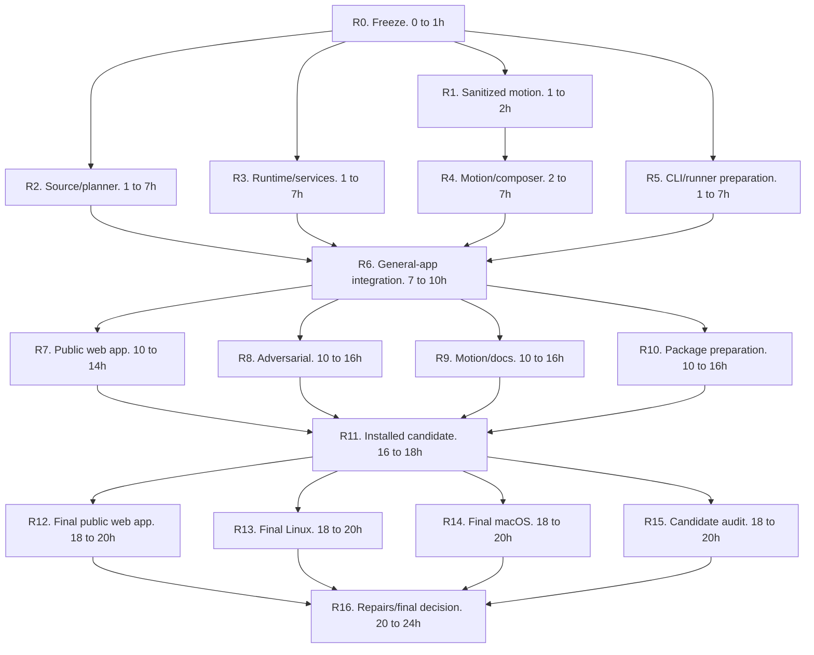

# Revision 0.3 implementation graph

This graph plans the incremental migration from the existing candidate to [specification revision 0.3](../spec.md). Implementation is active. The [status ledger](../evidence/revision-0.3-status.json) records current evidence; pending gates are not accepted. The revision 0.2 graphs remain in [the Markdown archive](audit/implementation-graph.r02.md) and [the JSON archive](audit/implementation-graph.r02.json).

The 24-hour estimate assumes four owners, prepared Linux and macOS hosts, accessible representative public web app source, and a usable local Docker daemon with buildx. It is not a delivery guarantee. Missing prerequisites or failed gates can extend the work. The timer never changes the completion predicate.

The [machine-readable graph](implementation-graph.json) records dependencies, file ownership, time windows, outputs, gates, and stop conditions. A dependency finishes before its dependent starts. Participants consume the same four owner slots. There is no implicit fifth owner or review team.

## Authorized implementation

The activated goal implements revision 0.3 with bounded local commands, dependency installs in owned snapshots, capture, encoding, and local Docker work. Record the spec digest, baseline, checkout state, platform capabilities, four permanent owners, and target time. Preserve unrelated work. Public actions remain unauthorized.

The public contract uses redistributable applications and synthetic dependencies. Keep private application inputs and results entirely outside the repository. Production credentials, remote migrations, paid providers, and public sharing require their own authorization. The owner-requested privacy correction supersedes earlier application-specific acceptance inputs.

Implementation reaches `ready_for_owner_publish` only when G01 through G24 have accepted current evidence for one exact candidate. Each gate needs commands, source identity, expected result, actual exit code, artifact evidence, and independent acceptance. Bind the implementation commit, source archive, tarball, and spec digests. Changed package inputs invalidate affected candidate evidence. Historical passes cannot satisfy a new gate.

G24 accepts a complete reviewed publishing handoff without publication. A separately authorized publication goal also requires observed public repository/package availability and an independent installation of the published version.

## Four permanent owner slots

| Owner | Write ownership | Approved model |
| --- | --- | --- |
| Integrator | Schema, CLI, runner, shared contracts, root package files, CI, integration, release ledger | `gpt-6-astra`, `xhigh`, for judgment |
| Worker A | Workspace, pure planner, general-app source fixtures, public web-app acceptance harness/evidence | `gpt-6.1-sol`, `xhigh` |
| Worker B | Runtime, containers, state/authentication, adversarial lifecycle tests, Linux harness | `gpt-6.1-sol`, `xhigh` |
| Worker C | Recorder, composer, motion fixtures, synthetic demos, agent documentation, macOS media checks | `gpt-6.1-sol`, `xhigh` |

The integrator can use `gpt-6.1-sol` with `xhigh` for a bounded coding turn in its own slot. Independent judgment uses `gpt-6-astra` with `xhigh`. The second implementation review uses `gpt-6.1-terra` with `xhigh` in Worker B's available slot, replacing that slot's model. It adds no owner. Model and reasoning effort are separate fields. An unavailable approved model requires a supported replacement.

All configured models belong to the GPT family. The cross-family judge pool is empty. Reviews can use different configured models but cannot claim cross-family agreement.

Owners use isolated worktrees or disjoint files. The integrator alone changes shared types and the dependency lockfile. New tests have explicit owners. Review findings return to the permanent file owner for repair. Node evidence uses `evidence/revision-0.3/R<ID>.md`. Private application inputs, source patches, environment/auth files, and recordings stay outside the repository. Public acceptance inputs must be redistributable.

## Checkpoints and capacity

| Hours | Integrator | Worker A | Worker B | Worker C |
| --- | --- | --- | --- | --- |
| 0 to 1 | R0 freezes contracts/capabilities | Available | Available | Available |
| 1 to 2 | R5 | R2, including source-volume probe | R3, including Docker ownership probe | R1 |
| 2 to 7 | R5 | R2 | R3 | R4 |
| 7 to 10 | R6 integration | R6 reviews recorder/composer | R6 reviews source/planner | R6 reviews runtime/runner |
| 10 to 14 | R10 | R7 | R8 | R9 |
| 14 to 16 | R10 | Available for representative web app repairs | R8 | R9 |
| 16 to 18 | R11 | Available | R11 package review | Available |
| 18 to 20 | R15 | R12 | R13 | R14 |
| 20 to 24 | R16 decision/evidence | R16 fresh-agent recipe check/repairs | R16 second review/repairs | R16 media review/repairs |

The critical path passes through R0, the slowest of R2/R3/R4/R5, R6, the slowest of R7/R8/R9/R10, R11, the slowest of R12/R13/R14/R15, and R16. R1 is a required predecessor of R4. Hours 20 to 24 are reserved for verification and repairs.

| Hour | Required observation | If the checkpoint fails |
| --- | --- | --- |
| 2 | Full synthetic CDP PNG capture, in-memory fixed masks, clock mapping, scheduling, encode, and decoded output. Source-volume/service-ownership probes also have results. | Diagnose feasibility and replan. A raw screencast probe alone does not pass. |
| 10 | Integrated CLI produces useful safe general-app motion from an explicit recipe. | Stop enhancements and route blockers to existing owners. |
| 14 | Public web app produces both normal-route comparisons, including a visible candidate change. | Keep G19 blocked. Diagnose the selected application or generic recipe failure before changing inputs. |
| 18 | Clean installed tarball runs revised commands and cross-stack examples. | Repair package boundaries before final candidate runs. |
| 24 | G01 through G24 have exact-candidate acceptance and a reviewed handoff. | Report exact incomplete gates. No deadline-based readiness or publication. |

## Node contracts

The JSON graph gives each node its exact file patterns, verification obligations, and stop conditions. These cards describe the implementation sequence. Gate assignments describe work to do, not passing status.

### R0. Freeze schema 2 and interfaces, hours 0 to 1

The integrator freezes strict recipe, Plan, RunContext, resource, CaptureBundle, Timeline, and envelope contracts. Generate schema 2 and reject v1 inputs with a migration diagnostic. Agree on module signatures and record installed API/capability outcomes, including Docker endpoint/buildx availability, before parallel contract work. Retain existing process supervision and the trusted canvas. G01 applies. Conflicting examples or missing capabilities stop dependent work.

### R1. Prove sanitized full motion, hours 1 to 2

Worker C runs a synthetic full-path prototype after R0. Capture actual PNG frames with `Page.startScreencast`, require monotonic timestamps, mask in memory before persistence, bound/acknowledge queues, align clocks, schedule real frames, encode, and inspect decoded movement/pulses. G10, G11, G12, and G14 guide feasibility. This is not final acceptance. Missing clocks, raw persistence, broken masks, or unexplained stalls stop media implementation.

### R2. Generalize source, recipes, and pure planning, hours 1 to 7

Worker A streams whole-repository inventories, copying, hashes, and Git blobs after R0. Remove npm/root-manifest/workspace rejection rules. Preserve exact-ref and final WORKTREE semantics, shared packages, caller state, and post-command provenance. Move installation policy into runtime. Normalize explicit recipes without execution, retain conservative optional Next discovery, and pin saved plans. Supply positive static/Python/npm/pnpm fixtures, with no fake npm manifests. G02, G03, G04, G05, and G18 apply. Source races, omitted tracked input, or caller changes block integration.

### R3. Extend owned runtime and services, hours 1 to 7

Worker B implements setup, ordered services, app startup, readiness, bootstrap, private environments, and separate app runtimes after R0. Preserve process-group/listener identity and cancellation. Add restricted Docker Engine builds, per-side labeled networks/containers/data, inspected ports/ownership, image-declared volume checks for apps and services, a disposable buildx builder with owned state volumes, interrupted-create/build reconciliation, and exact cleanup. Never prune unrelated resources or implement arbitrary Compose. Test independent auth storage with a synthetic app and disclose external-read-only parity. G05, G06, G07, G15, G16, and G17 apply. Uncertain ownership, secrets, or unverified cleanup block assigned gates.

### R4. Implement motion and composition, hours 2 to 7

Worker C extends recorder/composer after R1. Keep normal animation, strict actions, smooth inner scroll, hover, timed failure markers, and honest absence/exclusion results. Validate clocks, queues, dimensions, hashes, and rectangles before writes. Port explicit keyframes with selector masks into schema 2. Compose actual frames at original speed with trusted overlays and bounded FFmpeg work. Offline compose has no browser/app dependency and preserves earlier outcome faults. G08 through G14 apply. Synthetic motion, raw frames, mask failures, unsafe filters, or false success stop integration.

### R5. Prepare CLI and runner, hours 1 to 7

The integrator migrates schema 2 defaults, consent, saved plans, JSON envelopes, resource registration, artifact/null handling, status reduction, and doctor capabilities after R0. Owners keep their module logic. G01, G18, and G20 apply. Plan and doctor execute no app commands. Re-encoding cannot clear capture/source/cleanup faults.

### R6. Integrate and review, hours 7 to 10

The integrator joins R2, R3, R4, and R5. Demonstrate complete host/container recipe comparisons and a required-failure run with safe partial media, exit 3, and correct time labels. Worker A reviews recorder/composer, Worker B reviews source/planner, and Worker C reviews runtime/runner. Each permanent owner repairs its own files. G04, G05, G06, G08, G09, G11, and G13 through G18 apply. Useful safe integrated media and resource cleanup define the hour-10 checkpoint.

### R7. Exercise representative public web-app flows, hours 10 to 14

Worker A selects and records redistributable source, license, runtime, and package-manager identity under [the general acceptance contract](web-app-acceptance.md) after R6. Install at the actual workspace root, build shared packages, and start the selected app in owned snapshots. Exercise menu or panel motion, inner scrolling at 390 by 844, and synthetic form feedback. Make a visible feedback change in an isolated candidate worktree. Disclose inert dependencies. G03 and G19 apply. Final G19 requires R12's installed-final-tarball repetitions. Private source, selectors, names, and recordings never enter the public repository.

### R8. Attack failures, hours 10 to 16

Worker B tests source races, stale plans, generated-file boundaries, redirects, port fallback, unrelated listeners, interrupted Docker creates/builds, app/service image-declared volumes, unrelated builder/image survival, auth rejection, output escapes, PID reuse, stale ledgers, and repeated clean after R6. Inject signals/deadlines during setup/build/create/startup/recording/encoding. Check public artifacts and bounded logs for secrets/fill values. Route findings to module owners. G02, G03, G05, G06, G07, G09, G11, G12, and G15 through G18 apply. Cleanup, privacy, or provenance failures block candidate freeze.

### R9. Verify motion and public instructions, hours 10 to 16

Worker C measures positions, gaps, pulse alignment, uncertainty, and decoded media after R6. Prepare both platform harnesses and normal-speed review. Preliminary runs do not replace final-candidate motion evidence. Write accurate cross-stack quickstarts, support/state/mask limits, the generic agent skill, and synthetic success/partial motion demos. G10, G11, G13, G14, and G22 apply. The skill cannot invent consent, weaken required steps, or claim complete UI coverage. Private application material never enters demos.

### R10. Prepare package checks, hours 10 to 16

The integrator prepares the allowlist, CI, clean-install harness, literal quickstarts, bundled schemas/font/skill, cross-stack smoke, and offline compose after R6. Complete license/notices and other public package inputs before R11 freezes the tarball. Record configured lint/format checks or their explicit absence. G20, G21, and G22 apply. Required assets, source-tree independence, and accurate claims are mandatory before packaging.

### R11. Install the candidate, hours 16 to 18

The integrator builds, packs, inspects, hashes, and clean-installs after R7, R8, R9, and R10. Worker B independently reviews the package. Run help, doctor, plan, compare, compose, clean, and cross-stack examples through the installed artifact. Verify runtime separation and manifest-free static/Python inputs. G04, G20, and G21 apply. Private contents, missing assets, or source-tree dependencies block final acceptance.

### R12. Accept the public web-app comparison, hours 18 to 20

Worker A runs both normal-route scenarios three consecutive times through R11's final installed tarball. Review useful motion, the actual feedback change, exact public inputs/source identity, caller/index/dependency preservation, and absence of owned resources after each run. Save a public repeat recipe and verify a subsequent WORKTREE comparison. G03 and G19 apply. Failed runs or undisclosed substitutions block acceptance.

### R13. Accept Linux and Docker, hours 18 to 20

Worker B runs final installed-package/full-suite Linux checks after R11. Repeat the complete motion/mask/compose path three times. Record section 7.4 metrics and normal-speed review. Exercise Docker success, startup failure, interrupted build/create, volume ownership, cancellation, timeout, and unrelated-resource survival. G04, G07, G10, G11, G12, G15, G16, G20, and G21 apply. Missing platforms or Docker remain blockers.

### R14. Accept macOS and media, hours 18 to 20

Worker C runs final installed-package/full-suite macOS checks after R11. Repeat complete motion/masking/composition three times. Inspect motion metrics, timed failures, narrow letterboxing, decoded first/boundary/final images, poster choice, and offline compose. G04, G10 through G15, G20, G21, and G22 apply. Numeric minimums do not override visibly poor motion.

### R15. Audit and prepare publishing, hours 18 to 20

The integrator binds candidate/archive/tarball/spec hashes, scans history/package contents, triages advisories/notices, and reviews the public archive after R11. This audit reads frozen package inputs. A required package edit invalidates the candidate and returns to the rebuild/revalidation path. Prepare exact repository/license/npm ownership/auth/provenance prerequisites, publish commands, rollback/deprecation guidance, and independent post-publish verification. G23 and G24 apply. This node performs no visibility change, upload, registry write, or publication.

### R16. Repair and decide, hours 20 to 24

The integrator accepts evidence after R12, R13, R14, and R15. Worker A uses a fresh agent in its existing slot to follow a documented custom recipe. Worker B supplies Terra's second review. Worker C reviews final motion at normal speed. Astra supplies the final judgment in the integrator slot. Review independence does not imply a different model family.

Fix required defects, then rerun affected checks. Changed package inputs require a new candidate identity and affected installed-package/platform/motion/representative web app runs. Audit G01 through G24. All accepted gates yield `ready_for_owner_publish`. Anything less yields exact incomplete gates, with no public mutation.

## Review loop and stop conditions

Each node follows a contract example, focused behavioral check, implementation, verification, independent review, and integration. After two focused repairs fail the same requirement, diagnose the contract or architecture before trying again. Shared-interface changes require integrator approval and affected dependent rechecks.

Stop the affected path for missing required tools/platforms/models/Docker/representative web app, invalid source clocks, failed privacy/motion acceptance, unsupported source volume/layout, source mutation, caller changes, uncertain ownership, resource residue, private public artifacts, failed required actions, or inconsistent candidate identities. Report the gate and evidence. Continue independent safe work where possible.

Replan estimates without weakening requirements. Extra presets, caches, route adapters, hosting integrations, and visual polish are the first deferrals. Actual motion, all-frame masks, representative web app, identity, caller preservation, truthful failures, and cleanup remain mandatory.
